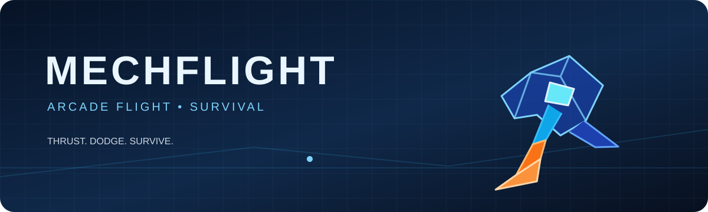

<div align="center">



<p>
  <strong>A 2D arcade flight game built with Python and Pygame.</strong><br>
  Pilot your mech, dodge the obstacles, and chase your best run.
</p>

<p>
  
  
  
</p>

<p>
  <a href="#-gameplay">Gameplay</a> ·
  <a href="#-features">Features</a> ·
  <a href="#-getting-started">Getting started</a> ·
  <a href="#-controls">Controls</a>
</p>

</div>

---

## ✦ Gameplay

Mechflight is a side-scrolling survival game where flight is all about timing. Hold your jetpack to rise, release to descend, and navigate an increasingly challenging course.


## 🚀 Features

- Full-screen, side-scrolling arcade gameplay
- Jetpack flight with gravity-based movement
- Animated mech sprites and explosion effects
- Difficulty that ramps up as the run continues
- Login and registration UI
- High-score tracking with optional MySQL persistence

## 🎮 Controls

| Action | Input |
|:--|:--|
| Fly upward | Hold <kbd>Space</kbd> |
| Descend | Release <kbd>Space</kbd> |
| Navigate menus | Mouse |
| Exit / return | <kbd>Esc</kbd> |

## ⚙️ Getting started

### Requirements

- Python 3.8+
- pip
- MySQL Server only if using database-backed score storage

### 1. Clone

```bash
git clone https://github.com/vishtodev/mechflight.git
cd mechflight
```

### 2. Create a virtual environment

**Windows (PowerShell)**

```powershell
py -m venv .venv
.venv\Scripts\Activate.ps1
```

**macOS / Linux**

```bash
python3 -m venv .venv
source .venv/bin/activate
```

### 3. Install and launch

```bash
python -m pip install --upgrade pip
pip install -r requirements.txt
python main.py
```

Launch from the repository root so the game can locate its assets.

## 🗂️ Project structure

```text
mechflight/
├── main.py                 # Game loop, menus, login and score logic
├── requirements.txt         # Python dependencies
├── docs/
│   └── mechflight-banner.svg
├── Script.txt              # Game text / script
├── ARCADE*.TTF             # Arcade fonts
├── perfect-dark-brk/       # Additional font assets
├── sprite*.png             # Mech animation frames
├── explosion*.png          # Explosion animation frames
├── obstacles.png           # Obstacle artwork
├── back*.jpg               # Background / UI artwork
└── ...                     # Remaining game assets and files
```

## 🧰 Built with

| Technology | Purpose |
|:--|:--|
| [Python](https://www.python.org/) | Game logic |
| [Pygame](https://www.pygame.org/) | Rendering, input and game loop |
| [Tkinter](https://docs.python.org/3/library/tkinter.html) | Login / registration interface |
| [Pillow](https://python-pillow.org/) | Image handling |
| [MySQL Connector/Python](https://dev.mysql.com/doc/connector-python/en/) | Optional score database |

## 🔐 Security note

This is a learning/demo project. The current authentication and database implementation has legacy security issues, including credentials in source and local pickle-based user data.

- Do not use it with real accounts or sensitive information.
- Rotate any database credential that was committed.
- Never use a MySQL root account for the game.
- Move secrets to environment variables or ignored local configuration.
- Replace plaintext password storage with secure password hashing.
- Do not load pickle files from untrusted sources.

## 🤝 Contributing

Ideas and bug reports are welcome. For bug reports, include your operating system, Python/Pygame versions, and steps to reproduce the issue.

## 📄 License

No license file is currently included. Until a license is added, all rights are reserved; please do not assume the project is available for reuse.

---

<div align="center">
  <sub>Built to fly. Designed to survive.</sub>
</div>
